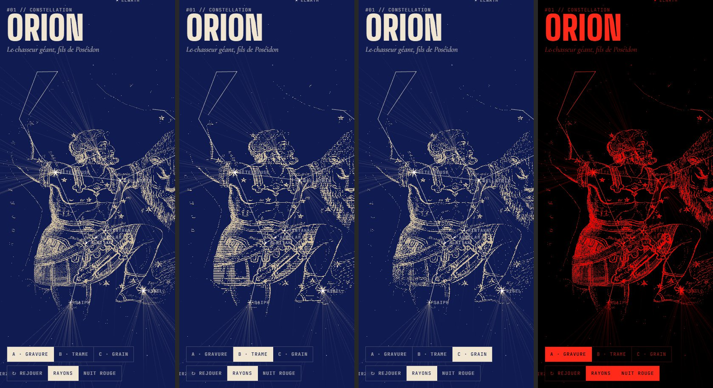

# Direction artistique

> Statut : **validée** par le porteur du projet (2026-09-30). Palette fixée. **Style de figure retenu : A — gravure tramée 1-bit (Bayer 8×8)**, sans rayons. D'autres améliorations stylistiques seront étudiées plus tard.
> Référence analysée le 2026-09-30 : https://hermes-agent.nousresearch.com/ (HTML, CSS et visuels). On reprend le **style**, pas les couleurs ni les images (droits de Nous Research : aucune de leurs images ne doit entrer dans le repo).

## 1. Ce qui fait le style Hermes Agent (analyse)

### Imagerie
| Visuel du site | Technique | Ce qu'on en retient |
|---|---|---|
| **Hero** — Hermès à six bras tenant des faisceaux de rayons | Gravure classique (taille-douce, hachures) en blanc sur noir, **rayons en fils fins** qui partent des mains, halo de rayons concentriques, fond marbré / éclairs | Les figures mythologiques sont des **gravures anciennes** mises en scène avec des **lignes géométriques fines** qui rayonnent → pour nous : les lignes de constellation sont ces fils |
| **Buste d'Hermès + fenêtres d'interface** | Statue en **tramage à points (halftone/dither 1-bit)**, glitch, fenêtres UI flottantes, yeux recadrés | Le mythique se mêle à des **panneaux de données** flottants |
| **Visage en lignes de balayage** | **Scanlines horizontales** faites de points (effet écran CRT / impression) | Texture de révélation / chargement |
| **Ange dans les nuages** | Gravure **inversée** (négatif), grain stochastique fort | Grain et négatif = aspect mystique, onirique |
| **Carré damier + tourbillon** | Motif **damier pixel**, bordure de carrés, lignes ondulantes vers un centre, petite figure au centre | Cadres et bordures **pixel/damier** ; compositions centripètes (idéal pour les tourbillons et vortex) |

**Points communs** : monochrome (noir profond + blanc), **1-bit / tramage**, grain, gravure ancienne, géométrie fine et nette, contraste maximal, un seul accent de couleur ailleurs dans l'UI.

### Typographie (relevée dans le CSS)
- Titres : **grotesque compressée/condensée** très haute (*Rules Gothic Compressed*), en capitales, très grande.
- Corps : grotesque variable sobre (*Rules*).
- Métadonnées / labels : **monospace** (*Aeonik Fono*, *Hermes Legacy Mono*), en capitales, **letter-spacing 0.1em**, numérotation `#1 Connect`, `//`.
- Un **serif display** (*Sigurd*) pour les touches solennelles.

### Mise en page et UI
- **Angles vifs** (border-radius 0 ou très faible), **filets fins (hairlines)** pour structurer.
- Sections numérotées, beaucoup de noir, blocs de texte courts.
- Modes de fusion (`screen`, `lighten`, `exclusion`, `plus-lighter`) pour superposer l'art et l'UI.
- Blocs de code/terminal utilisés comme éléments graphiques.

## 2. Palette (validée)

| Token | Valeur | Rôle |
|---|---|---|
| `--ast-night` | **#101B52** | Fond : bleu nuit profond (remplace le noir de Hermes) |
| `--ast-parchment` | **#F0E6D2** | Encre : parchemin (remplace le blanc) — étoiles, gravures, texte |
| dérivés | `color-mix()` des deux | Filets (parchemin ~15-25 %), surfaces (nuit éclaircie de 4-8 %), texte secondaire (parchemin ~65 %) |
| `--ast-night-deep` | ≈ #0A1136 | Fond plus sombre pour le ciel en mode Live (contraste des étoiles faibles) |
| nuit rouge | #FF2A1A sur #000 | Mode vision nocturne : les deux tokens sont remappés |

Principe : **deux tons**, comme une gravure imprimée à l'encre parchemin sur papier bleu nuit (cyanotype inversé). Le tramage 1-bit utilise exactement ces deux couleurs. Les couleurs physiques des étoiles (B-V) restent très désaturées et ne s'affichent qu'en niveau Amateur/Expert ou à fort zoom.

## 3. Traduction pour Asteria : « Gravure céleste computationnelle »

### Le ciel
- Fond **bleu nuit #101B52** uni (pas de dégradé cartoon). Étoiles nettes, couleur physique très **désaturée** (B-V) pour rester presque monochrome ; en mode « Pur », 100 % parchemin.
- **Lignes de constellation = fils de lumière fins**, nets, comme gravés. (Les rayons façon hero Hermes ont été testés puis écartés.)
- Voie lactée : **lueur diffuse et transparente** violet / bleu profond sur la carte, ajoutée au ciel sans jamais masquer une étoile (choix du porteur, #168, après un essai en grain de points en #162) ; même lueur dans la vue Terre en style gravure ; en style réaliste, bande de photo à longue pose sur ciel noir.

### Les figures mythologiques (le cœur de la DA)
- Style : **gravure ancienne** (référence : atlas de Bayer *Uranometria* 1603, Hevelius 1690, *Urania's Mirror* 1824 — tous **domaine public**) retravaillée par artiste + IA, puis rendue en temps réel par shader :
  - **Tramage 1-bit** (Bayer / blue-noise) ou **halftone** ;
  - variante **scanlines** pour les transitions ;
  - **grain** et léger glitch à l'apparition.
- **Apparition** : la figure « se révèle » depuis les étoiles, les points de trame se densifient.
- ~~Cadres damier/pixel pour les cartes de collection~~ : abandonnés (#185, jugés lourds par le porteur) ; voir « Cartes » dans L'interface.

### L'interface
- Titres : grotesque compressée en capitales (candidates libres : *Anton*, *Bebas Neue*, *Big Shoulders Display*, *Oswald* ; à tester).
- Données : **monospace en capitales**, espacées (`RA 05H 55M 10.3S · DEC +07° 24′ 25″`), apparition caractère par caractère. Candidates : *JetBrains Mono*, *IBM Plex Mono*, *Space Mono*.
- Solennel : serif display pour les noms mythologiques (candidates : *Cormorant*, *Cinzel*, *EB Garamond*).
- Angles vifs, filets fins, panneaux flottants façon fenêtres (comme le buste Hermès).
- **Séparer les parties : des panneaux, pas des numéros** (#171, demande du porteur). Les intitulés numérotés façon Hermes (`#01 // TITRE`, `//` en préfixe) sont abandonnés partout. Une partie d'écran ou de fiche est un **panneau minimaliste** : filet fin (`--ast-panel-border`, parchemin 20 %), lavis d'encre très léger (`--ast-panel-bg`, parchemin 4 %), marge intérieure généreuse (`--ast-panel-pad`, 14 px), 12 px entre deux panneaux (`--ast-panel-gap`) ; titre court en capitales espacées (mono 10 px, interlettrage 0,12 em, parchemin 65 %), sans numéro ni barres obliques. Classes globales `.panel-block` / `.panel-title` (`apps/web/src/app.css`). Les éléments d'une même partie se séparent par un simple filet. L'en-tête de la carte n'affiche que le titre et le lieu (« CARTE DU CIEL · PARIS ») ; dans les lignes de données, le séparateur est le point médian « · ». En nuit rouge, le lavis devient un rouge très sombre sur noir (mêmes jetons).
- **Cartes (catalogue, jeux) : une vignette, pas un cadre** (#185, demande du porteur). **Aucun contour en tirets ni cadre damier/pixel** autour d'une carte, d'une étiquette ou d'une case : le pointillé est réservé aux tracés du ciel (trait faux, trajectoire). Une carte est un panneau (#171) qui porte une **vignette** de ciel tramé dessinée par le code (`lib/vignettes.ts`, grille de 40 pixels, fond tramé Bayer 8×8 à double résolution, étoiles en pixels entiers, fils fins qui s'arrêtent avant les étoiles, trame dégagée sous les fils), le titre, une ligne d'accroche, le record ou la progression (jauge de pastilles ou réglet d'une graduation par constellation) et **une seule action** pleine qui couvre toute la carte (un toucher n'importe où). Hiérarchie de l'écran par des intitulés de groupe (capitales espacées prolongées d'un filet), pas par des cadres imbriqués. Apparition : la trame de la vignette se densifie en trois pas (rien en mouvement réduit).
- **Réglages et défis des jeux** (#187) : réglages dans une feuille qui monte sur l'écran Apprendre (pas de nouvel écran) ; choix en tuiles segmentées (la tuile choisie inversée, comme le niveau) et en lignes à case pleine, jamais en tirets. Pictogrammes 1-bit au pixel. En défi, le chiffre (série ou chrono) en grande capitale compressée dans l'en-tête ; le temps restant est un filet d'encre qui se vide le long du bas de l'en-tête (animation CSS) ; les 10 dernières secondes, chiffres sur plaque d'encre. Nouveau record : quelques étoiles-pixels lancées autour du nombre et une plaque « Nouveau record ! » ; rien ne bouge en mouvement réduit.
- **Zones de visibilité** (« Selon la latitude », #188, puis #197 à la demande du porteur) : **exception circonscrite à la palette bichrome**, la seule couleur d'interface hors des deux encres. Les zones sont des **lavis colorés translucides** posés sur le ciel, qui laissent voir les étoiles, les figures et les frontières : ciel qui ne se couche jamais en **vert-de-gris** (`--ast-zone-always`, #63C2B0 à 30 %), ciel qui ne se lève jamais en **sanguine** (`--ast-zone-never`, #F0784E à 32 %), bande qui se lève et se couche **dégagée**. Ce sont deux encres d'atlas ancien (patine du cuivre gravé, craie rouge) qui s'accordent au bleu nuit et au parchemin. En nuit rouge, seulement du rouge : les deux zones deviennent deux intensités de l'encre rouge (40 % et 16 %). **Jamais la couleur seule** : chaque zone garde un repère de forme et un libellé (limites tracées d'un trait plein d'encre, noms « TOUJOURS » / « JAMAIS » sur les calottes de la sphère, compte et nom de chaque bande sur la carte, pastille + nom dans les listes). Sur la sphère, la face arrière vue à travers le verre est lavée à 42 % de la face avant ; le sol (disque de l'horizon) reste gravé de traits horizontaux fins. Jetons dans `packages/ui/src/tokens.css` (couleur et opacité séparées, lues par les dessins ; `--ast-zone-*-wash` pour le CSS). Ne pas étendre ces couleurs à d'autres écrans sans décision du porteur. Les **chiffres** d'une carte en bandes s'écrivent **sur leur bande** (pastille, nombre en capitale compressée, nom de la zone), pas dans une légende séparée. La carte de tout le ciel s'**agrandit** en plein écran (glisser pour la faire tourner, pincer pour zoomer, curseur de latitude en bas).
- **Degrés de maîtrise** (« Ton ciel ») : la case se remplit par le bas, la trame se densifie avec la hauteur : rien, un tiers en points fins (25 %), moitié en damier (50 %), plein ; le nom reste lisible au-dessus du remplissage. Deux indices (hauteur et densité), lisibles sans couleur.
- Palette **bichrome** nuit #101B52 / parchemin #F0E6D2 (voir §2) ; pas d'autre couleur d'interface, sauf l'exception des zones de visibilité ci-dessus (#197).
- **Mode nuit rouge** : conversion intégrale en rouge sur noir. Le style 1-bit s'y prête parfaitement : c'est un atout majeur de cette DA.

### Grand public ↔ professionnels
- Même langage visuel pour tous. Le niveau **Découverte** montre davantage les figures et moins les données ; le niveau **Expert** fait l'inverse (panneaux de données denses, figures en retrait ou désactivées).

## 4. Pipeline des figures (artiste + IA)
1. Source : gravure d'atlas ancien du domaine public (Bayer, Hevelius, Flamsteed/Fortin, *Urania's Mirror*) **ou** création originale.
2. Recomposition IA + retouche artiste : pose alignée sur les étoiles réelles (gabarit généré depuis nos données), style gravure homogène.
3. Export en niveaux de gris haute définition + masque + points d'ancrage (étoiles).
4. Rendu temps réel : shader de tramage/halftone/scanlines → un pipeline unique pour les 88 figures et les autres cultures.
5. Chaque figure : fiche de provenance (source, artiste, outil IA, licence) dans `packages/content/figures/`.

## 5. Livrables Phase 0 (ticket #4)

**Prototype disponible** : `prototypes/orion` (`pnpm --filter @asteria/proto-orion dev`). Captures : `docs/design/orion/`.

- Orion en 3 variantes : **A** gravure tramée 1-bit ✅ retenue, **B** halftone/scanlines, **C** particules/grain.
- Chaque variante en mode nuit rouge.
- Planche typographique (3 combinaisons).
